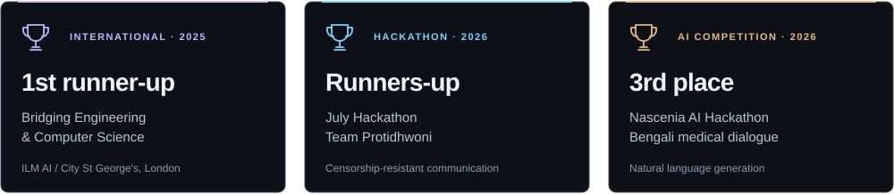

  

  

  
  
  
  

Khulna, Bangladesh &nbsp; / &nbsp; CSE @ KUET &nbsp; / &nbsp; Engineering student, forever learner.

  
  
  
  
  
  

## About me

I'm a **CSE undergraduate at KUET**, focused on **GPU computing, efficient AI, and computer vision**. I work with **Kent State University's ATR Lab as an unofficial international research intern**, under Prof. Jong-Hoon Kim, and as a **Software Engineer at Logarithm Studio**.

I care about research that can be measured and reproduced: smaller models, faster computation, and systems that hold up outside a notebook. My long-term direction is **space technology and exploration**; I'm also part of **Team Durbar, KUET's Mars rover team**.

## Research & publications

  
  
  

### Selected publications

**[Learning-Driven Layered Knowledge Construction with Structured Fine-Tuning and Human-in-the-Loop Reasoning for Multi-Robot SAR](https://ieeexplore.ieee.org/document/11714938/)** 
*IEEE RO-MAN 2026 · Co-author · Published*

Parameter-efficient fine-tuning, layered local/global reasoning, and human feedback for knowledge sharing in multi-robot search and rescue.

**[Medora: A Consent-Aware, AI-Native Bilingual Platform for Healthcare Management and Consultation](https://scholar.google.com/citations?user=l_J2QaYAAAAJ&hl=en)** 
*Journal · 2026 · Published*

A bilingual healthcare platform for Bangladesh, studying how deterministic consent and policy boundaries can govern assistive AI.

**Also on the research track:** submissions under review at **ICRA 2027** and **ICCIT 2027**, and an **IHCI 2026 poster paper**.

### Current research

- **GPU & efficient AI:** CUDA, sparse and tensor computation, model compression, and parameter-efficient fine-tuning.
- **ICASSP 2027 FLAG Challenge:** cross-lingual face-voice verification, with architecture and gradient parity checks for a reproducible FOP baseline.
- **Vision Transformer explainability:** extending F2HF's FFN-weighted attention-head filtering toward a journal paper.
- **DriftRisk-LoRA:** my undergraduate thesis on drift-aware financial risk modelling with market data and macro-text.

[Google Scholar](https://scholar.google.com/citations?user=l_J2QaYAAAAJ&hl=en) &nbsp; · &nbsp; [Research details](https://portfolio-v2-sarwad.vercel.app/#research) &nbsp; · &nbsp; [CV](https://portfolio-v2-sarwad.vercel.app/Sarwad-Hasan-Siddiqui-CV.pdf)

## Honors & achievements

  

| Recognition | Competition / institution | Year |
| :--- | :--- | :--- |
| **International 1st runner-up** | Bridging Engineering & Computer Science · ILM AI Ltd. and City, St George's, University of London · Team Kuet_Kobe_Khulbe | 2025 |
| **Runners-up** | July Hackathon · Team Protidhwoni · Censorship-resistant communication | 2026 |
| **3rd place** | Nascenia AI Hackathon · Bengali medical dialogue generation | 2026 |
| **Dean's List** | KUET · First and second year | 2025, 2026 |
| **Dean's Award** | KUET · First year | 2025 |
| **Finalist** | Blockchain Olympiad Bangladesh · Team Logarithm | 2026 |
| **3rd runner-up** | Case Crack 2.0 · KUET Business & Entrepreneurship Club | 2025 |
| **2nd place** | Spark Fusion 2K21 · Hardware design | 2021 |

**B.Sc. in CSE, KUET · 2023–2027 · CGPA: 3.78 / 4.00**

[More about my honors and background](https://portfolio-v2-sarwad.vercel.app/#honors)

## 🌈 My tech universe

### 🧠 AI, research & GPU computing

          

### 💻 Languages

         

### 🎨 Web, mobile & interfaces

      

### ⚙️ Backends, data & cloud

                 

### 🛠️ Tools, design & hardware

          

## 🎧 Outside the code

I help organise **TEDxKUET** and serve as **Secretary of PR at the KUET Business & Entrepreneurship Club**. Building things also means getting people in a room and making an idea happen together.

Away from the workbench: [music on Spotify](https://open.spotify.com/user/226r66vnosa7atjaky5tu6niy), [Instagram](https://www.instagram.com/pianto._/), and the occasional [post on X](https://x.com/Shspianto).

## 📊 GitHub activity

  

  

💬 A random dev quote, for old times' sake

  

## 👾 Chomp through my contributions

<picture>
  <source media="(prefers-color-scheme: dark)" srcset="https://raw.githubusercontent.com/polymathicX/polymathicX/output/pacman-contribution-graph-dark.svg" />
  <source media="(prefers-color-scheme: light)" srcset="https://raw.githubusercontent.com/polymathicX/polymathicX/output/pacman-contribution-graph.svg" />
  
</picture>

---

  <strong>✨ Have an interesting problem at the intersection of AI and systems?</strong> 
  Open to research collaborations, research internships, and graduate opportunities.  
  <a href="mailto:sarwad015@gmail.com">Let's talk</a> &nbsp; · &nbsp;
  <a href="https://portfolio-v2-sarwad.vercel.app/Sarwad-Hasan-Siddiqui-CV.pdf">Read my CV</a> &nbsp; · &nbsp;
  <a href="https://leetcode.com/u/Rockstatata/">LeetCode</a> &nbsp; · &nbsp;
  <a href="https://leetgpu.com/UnbreakableProdigyf0e38">LeetGPU</a>

