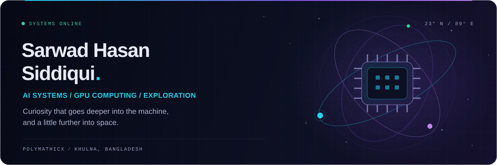

  

  
  
  
  

Khulna, Bangladesh &nbsp; / &nbsp; CSE @ KUET &nbsp; / &nbsp; Engineering student, forever learner.

## Hey, I'm Sarwad.

I like taking a difficult idea and turning it into something I can run, measure, and reproduce. I started with apps and full-stack development; these days, my curiosity keeps pulling me deeper into **GPU computing, efficient transformers, and computer vision**.

I'm pursuing my **B.Sc. in CSE at Khulna University of Engineering & Technology** (2023–2027). Alongside that, I work with **Kent State University's ATR Lab as an unofficial international research intern**, collaborating under Prof. Jong-Hoon Kim, and build AI-powered products as a **Software Engineer at Logarithm Studio**.

The long-term pull is **space technology and exploration**. For now, that shows up in GPU experiments, NASA-data projects, a solar system built from scratch, and being part of **Team Durbar, KUET's Mars rover team**.

> The question I keep coming back to: how do we make intelligent systems practical to run?

## On my workbench

| Direction | What I'm working on |
| :--- | :--- |
| **GPU & efficient AI** | CUDA, memory hierarchies, sparse and tensor computation, model compression, and LoRA / QLoRA. |
| **Cross-modal learning** | Face–voice verification for the **ICASSP 2027 FLAG Challenge**: reproducing the FOP baseline, checking architecture and gradient parity, then improving it. |
| **Interpretable vision** | Extending **F2HF**, an FFN-weighted attention-head filtering method for Vision Transformer explanations, toward a journal paper. |
| **Drift-aware ML** | **DriftRisk-LoRA**, my undergraduate thesis: financial risk modelling with versioned market data and a quality-gated macro-text corpus. |

Some research code is private. I write about the work on my [portfolio](https://portfolio-v2-sarwad.vercel.app/#research) and [journal](https://portfolio-v2-sarwad.vercel.app/blog).

## A few things I've built

<table>
  <tr>
    <td width="50%" valign="top">
      
      <h3><a href="https://github.com/polymathicX/Voyager-2">Voyager-2</a></h3>
      
A solar system from scratch: 26 textured bodies, NASA/JPL trajectories, and Voyager 2's journey out to the heliopause. Double-precision floating origin, shadow maps, and an optional ray-traced view.

      
C++20 · OpenGL · GLSL · NASA JPL Horizons

    </td>
    <td width="50%" valign="top">
      
      <h3><a href="https://github.com/CSE-3200-System-Project/Medora">Medora</a></h3>
      
Bilingual healthcare software for Bangladesh. Patient-held records, scoped consent, source-linked AI summaries, and human-reviewed clinical drafts, with a deterministic policy boundary around AI.

      
Next.js · FastAPI · PostgreSQL · Supabase · LLMs

    </td>
  </tr>
  <tr>
    <td width="50%" valign="top">
      
      <h3><a href="https://github.com/polymathicX/Dhara">Dhara</a></h3>
      
From a plain-Bangla question to the exact law section. Retrieval across 39,484 chunks from 1,227 Acts, studying the gap between everyday language and formal legal text.

      
Python · PyTorch · BGE-m3 · LoRA · Information retrieval

    </td>
    <td width="50%" valign="top">
      
      <h3><a href="https://github.com/polymathicX/Agun-Panjika">Agun Panjika</a></h3>
      
One fire history across sensors and seasons for Bangladesh. Harmonising MODIS and VIIRS observations into a bilingual fire calendar and early-warning outlook for NASA Space Apps 2026.

      
Python · React · D3 · Three.js · NASA FIRMS

    </td>
  </tr>
</table>

Also in orbit: [**Jagoo Bahee**](https://github.com/tasmirz/jagoo-bahee), a community platform designed to keep working through an internet blackout, and [**Interlink**](https://github.com/Logarithm-Studio/Interlink-backend), an AI agent for everyday and professional workflows.

[Explore the full project catalogue →](https://portfolio-v2-sarwad.vercel.app/#projects)

## Tools I reach for

| | Toolkit |
| :--- | :--- |
| **Research & models** | Python · PyTorch · Transformers · LoRA / QLoRA · Computer vision · NLP & retrieval |
| **Close to the hardware** | C / C++20 · CUDA · OpenGL / GLSL · Linux · Docker · Flex & Bison |
| **Products & interfaces** | TypeScript · React · Next.js · React Native · SwiftUI · Three.js |
| **Services & data** | FastAPI · Django · Node.js · PostgreSQL · Supabase · Firebase |

<strong>A few milestones along the way</strong>

- **Research:** co-author of work published at IEEE RO-MAN 2026 on layered knowledge construction for multi-robot search and rescue; further robotics work under review at ICRA 2027.
- **July Hackathon 2026:** runners-up with Team Protidhwoni for Jagoo Bahee.
- **Nascenia AI Hackathon 2026:** 3rd place for Bengali medical dialogue generation.
- **Bridging Engineering & Computer Science 2025:** international 1st runner-up with Team Kuet_Kobe_Khulbe for ParaBounce.
- **KUET:** CGPA 3.78 / 4.00, Dean's List in both first and second year, and a first-year Dean's Award.

## Beyond the experiments

I help organise **TEDxKUET** and serve as **Secretary of PR at the KUET Business & Entrepreneurship Club**. Building things also means getting people in a room and making an idea happen together.

Away from the workbench: [music on Spotify](https://open.spotify.com/user/226r66vnosa7atjaky5tu6niy), [Instagram](https://www.instagram.com/pianto._/), and the occasional [post on X](https://x.com/Shspianto).

## A little arcade in the contribution graph

<picture>
  <source media="(prefers-color-scheme: dark)" srcset="https://raw.githubusercontent.com/polymathicX/polymathicX/output/pacman-contribution-graph-dark.svg" />
  <source media="(prefers-color-scheme: light)" srcset="https://raw.githubusercontent.com/polymathicX/polymathicX/output/pacman-contribution-graph.svg" />
  
</picture>

---

  <strong>Have an interesting problem at the intersection of AI and systems?</strong> 
  Open to research collaborations, research internships, and graduate opportunities.  
  <a href="mailto:sarwad015@gmail.com">Let's talk</a> &nbsp; · &nbsp;
  <a href="https://portfolio-v2-sarwad.vercel.app/Sarwad-Hasan-Siddiqui-CV.pdf">Read my CV</a> &nbsp; · &nbsp;
  <a href="https://leetcode.com/u/Rockstatata/">LeetCode</a> &nbsp; · &nbsp;
  <a href="https://leetgpu.com/UnbreakableProdigyf0e38">LeetGPU</a>

